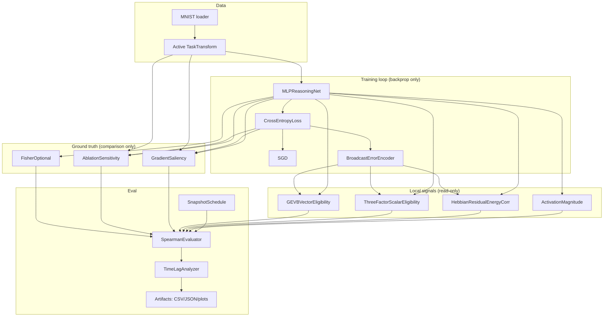
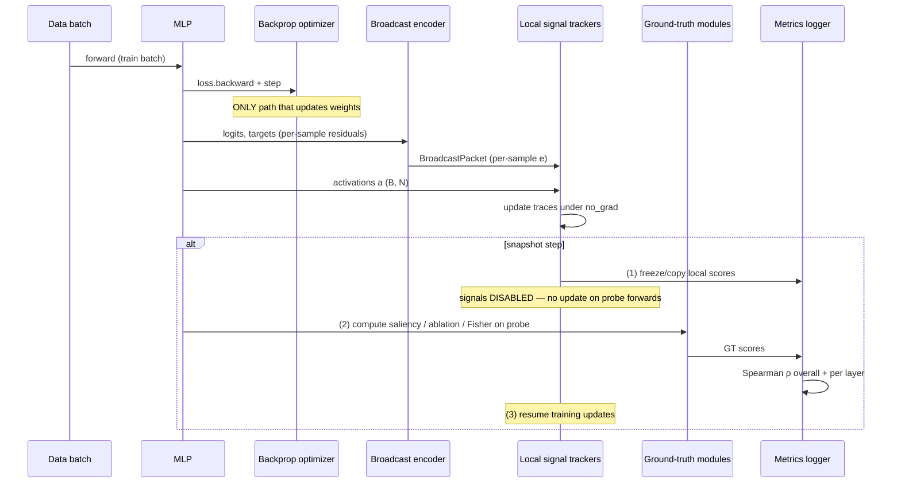
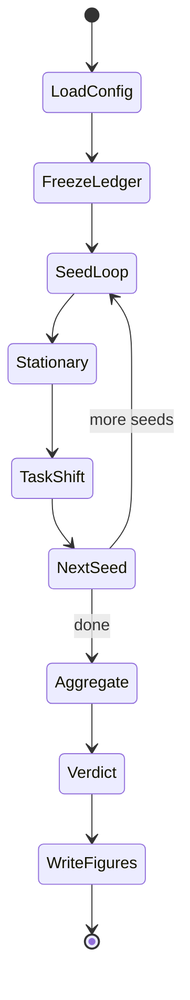
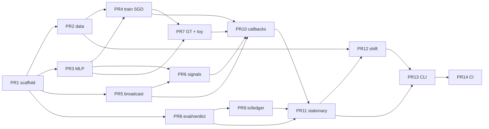

# Design Document: Local Importance Signal Validation (Phase 0)

| Field | Value |
|-------|-------|
| **Title** | Local Importance Signal Validation (Phase 0) |
| **Project** | NeuroNCA |
| **Author** | NeuroNCA design (Phase 0) |
| **Date** | 2026-07-20 |
| **Status** | Draft (R2 after second design review) |
| **Supersedes** | Prior draft *broadcast_error_learning_spec.md* (**not in this greenfield repo** — historical pointer only; wrong question: training rule vs. importance proxy) |
| **Audience** | Senior engineers implementing Phase 0 from a greenfield repo |
| **Revision** | R2 — switch-boundary GT sequencing, recovery ρ, phase1_go, polish |

---

## Overview

NeuroNCA’s long-term architecture assumes an orchestrator that grows and prunes a reasoning network using **only** local activations and a globally broadcast, compressed error signal. The orchestrator never sees per-parameter gradients, Fisher information, or other centrally computed importance measures. Before any growth/pruning code is written, Phase 0 answers a single proxy-quality question:

> Can a locally computable quantity built from local activity and a broadcast error term rank neurons and connections by importance well enough to stand in for gradient- and ablation-based ground truth — both on a stationary task and after a task shift?

This document specifies a full, implementable experimental system for a greenfield repository: package layout, exact signal formulas, broadcast-error definition, ground-truth measures, MNIST task-shift protocol, evaluation schedule, success thresholds, multi-seed verdict aggregation, artifact layout, and a single-command reproduction path. The reasoning network is trained exclusively with standard backpropagation; local signals are **observed alongside** training and never used to update weights or change topology.

**Scientific framing note (R1):** Phase 0 tests **two related but distinct** local proxies: (A) a **scalar residual-energy neuromodulator** (candidates 2–3), which is a compressed “when is the network wrong?” signal; and (B) a **vector GEVB-faithful eligibility** score with fixed random feedback (candidate 4), which preserves signed, direction-specific credit. A FAIL of (A) alone must **not** be reported as “broadcast residual proxies cannot work” without also reporting (B).

---

## Background & Motivation

### Why this phase exists

The earlier *broadcast_error_learning_spec.md* (prior draft, not checked into this repo) validated the wrong claim: it treated broadcast-error learning as a *training rule* for the reasoning network. That network was always going to train via ordinary backprop. The real risk for NeuroNCA is informational: if a future NCA orchestrator can only see local activity + a broadcast error term, is that enough to know **where structure matters**?

If the answer is no, every subsequent design choice (growth rules, pruning rules, distance costs, discrete structural credit assignment) is built on a false premise. Phase 0 is a cheap, fixed-topology experiment that either:

1. **Green-lights** a concrete local signal (and its time-lag properties) as the Phase 1 orchestrator’s importance proxy, or  
2. **Forces a redesign** of the orchestrator’s information access before any NCA code is written.

### Current state

Repository `/home/george-contis/Documents/NeuroNCA` is empty except for git metadata and a local `.venv`. There is no training loop, no data pipeline, and no instrumentation. This design is the first implementable artifact.

### Pain points Phase 0 must avoid

| Pain point | Mitigation in this design |
|------------|---------------------------|
| Conflating training rule with importance proxy | Weights always updated by backprop; local signals are read-only |
| Engineering signals until they “pass” | Fixed signal set; no iterative redefinition after seeing results; experiment ledger |
| Aggregate-only metrics hiding layer failures | Mandatory per-layer Spearman breakdown |
| Only testing stationary importance | Required task-shift condition with time-lag analysis |
| Vague / overclaimed broadcast error | Explicit scalar residual-energy vs vector GEVB candidates; honest naming |
| Batch-mean modulator nullifying three-factor structure | Per-sample residual default |
| Probe on wrong task after switch | Atomic shared `TaskTransform` for train + probe |
| GT probe polluting EMA traces | Snapshot isolation: freeze local scores, GT with signals disabled |

---

## Goals & Non-Goals

### Goals

1. Implement a small fixed-topology MLP trained on MNIST with standard backprop.
2. Implement **four** local importance candidates, all computable without per-parameter gradients of the reasoner: (1) activation baseline; (2) Hebbian residual-energy correlation; (3) three-factor residual-energy eligibility; (4) GEVB random-feedback eligibility.
3. Implement at least two ground-truth importance measures that require full gradient/ablation access.
4. Run **stationary** and **task-shift** experiments with scheduled snapshots.
5. Log rank correlations (Spearman ρ), per-layer breakdowns, and post-shift recovery lag (cheap GT on dense lag).
6. Record pass / partial-pass / fail against pre-declared thresholds with **explicit multi-seed aggregation**.
7. Deliver a single-command reproduction path and structured results artifacts.

### Non-Goals (explicitly out of Phase 0)

- No changes to how the reasoning network is trained (no broadcast-error weight updates).
- No NCA, CA grid, or local neighborhood topology for the orchestrator.
- No growth, pruning, rewiring, or any structural mutation based on any signal.
- No distance-dependent connection cost.
- No discrete structural decision credit assignment.
- No multi-task specialization studies beyond a single A→B shift.
- No iteration on signal formulas until one “passes” — report the break point honestly.
- No using weight magnitudes as a “local” candidate (would leak non-local parameter state; see Alternatives).

---

## Proposed Design

### High-level architecture



### Training vs. measurement separation



**Hard snapshot isolation rule:** On every snapshot, (1) copy/read local scores under `torch.no_grad()`, (2) run all GT with `LocalSignal.update` **disabled** (probe forwards must not touch EMA traces), (3) resume training. Unit test: trace tensors are bitwise-identical before and after a GT-only call.

---

## Package / Module Layout

Greenfield layout under the repo root:

```
NeuroNCA/
├── pyproject.toml
├── README.md
├── configs/
│   ├── default.yaml
│   ├── stationary.yaml
│   └── task_shift.yaml
├── scripts/
│   ├── run_phase0.py
│   └── reproduce.sh
├── src/
│   └── neuronca/
│       ├── __init__.py
│       ├── models/
│       │   ├── __init__.py
│       │   └── mlp.py
│       ├── data/
│       │   ├── __init__.py
│       │   ├── mnist.py
│       │   └── tasks.py
│       ├── training/
│       │   ├── __init__.py
│       │   ├── loop.py
│       │   ├── callbacks.py      # instrumented train step + snapshot isolation
│       │   └── optim.py
│       ├── broadcast/
│       │   ├── __init__.py
│       │   └── error.py
│       ├── signals/
│       │   ├── __init__.py
│       │   ├── base.py
│       │   ├── activation.py      # candidate 1
│       │   ├── hebbian_corr.py    # candidate 2
│       │   ├── eligibility.py     # candidate 3 (scalar residual energy)
│       │   └── gevb_eligibility.py # candidate 4 (vector GEVB-faithful)
│       ├── importance/
│       │   ├── __init__.py
│       │   ├── base.py
│       │   ├── gradient_saliency.py
│       │   ├── ablation.py
│       │   └── fisher.py
│       ├── eval/
│       │   ├── __init__.py
│       │   ├── correlation.py
│       │   ├── time_lag.py
│       │   ├── verdict.py         # multi-seed aggregation
│       │   └── schedule.py
│       ├── experiments/
│       │   ├── __init__.py
│       │   ├── stationary.py
│       │   └── task_shift.py
│       └── io/
│           ├── __init__.py
│           ├── config.py
│           ├── artifacts.py
│           ├── ledger.py          # experiment_id / config hash
│           └── seed.py
├── tests/
│   ├── test_models.py
│   ├── test_broadcast.py
│   ├── test_signals.py
│   ├── test_importance.py
│   ├── test_correlation.py
│   ├── test_tasks.py
│   ├── test_verdict.py
│   ├── test_snapshot_isolation.py
│   └── test_toy_gevb_ranking.py   # analytical ranking integration
├── results/
│   └── .gitkeep
└── docs/
    └── phase0_results.md
```

### Module boundaries

| Module | Responsibility | Must not |
|--------|----------------|----------|
| `models` | Network definition, forward, activation capture | Compute importance or update itself with local signals |
| `broadcast` | Map logits/targets → `BroadcastPacket` (per-sample + diagnostics) | Touch weights |
| `signals` | Maintain running local scores from `(a, broadcast)` only | Call `.backward()`, mutate weights, see GT, read `W` values |
| `importance` | GT scores using full gradient/ablation access | Feed into optimizers or structural changes; call `LocalSignal.update` |
| `training` | Backprop training loop + snapshot isolation callbacks | Use local scores for loss or structure |
| `eval` | Correlations, lag, schedules, multi-seed verdict | Retrain or redefine signals |
| `experiments` | Wire configs → runs → artifacts | Implement signal math (delegate) |
| `io.ledger` | experiment_id, config hash freeze | Mutate signals |

---

## Network Architecture Defaults

### `MLPReasoningNet`

| Parameter | Default | Notes |
|-----------|---------|-------|
| Input | 784 | Flattened MNIST 28×28 |
| Hidden layers | `[256, 128, 64]` | Three hidden layers; small enough for ablation |
| Output | 10 | Digit classes (or remapped labels under task B) |
| Activation | ReLU | Post-nonlinearity for hidden; **logits** for `fc_out` post |
| Bias | Yes | Biases exist; edge scores are weight-only |
| Init | Kaiming uniform (ReLU) | Standard |
| Weight parameters | \(784\cdot256 + 256\cdot128 + 128\cdot64 + 64\cdot10 =\) **242,304** | ~242k weights |
| With biases | +256+128+64+10 = **242,762** | ~243k total Linear params |

```python
# Conceptual interface — src/neuronca/models/mlp.py
class MLPReasoningNet(nn.Module):
    def __init__(self, input_dim=784, hidden=(256, 128, 64), num_classes=10):
        # Modules named exactly: fc1, fc2, fc3, fc_out
        ...

    def forward(self, x: Tensor) -> Tensor:
        """Returns logits. Populates self.last_activations (see naming table)."""

    def named_linear_layers(self) -> list[tuple[str, nn.Linear]]:
        """Ordered: ('fc1', ...), ('fc2', ...), ('fc3', ...), ('fc_out', ...)."""

    def layer_shapes(self) -> dict[str, tuple[int, int]]:
        """name -> (n_out, n_in) for signal allocation — no weight values."""
```

### Layer naming and activation keys (mandatory)

All modules, score dicts, and correlation `layer` columns use these **exact** Linear names. Activation dict keys are standardized (not `a_h1`):

| Linear name | Presynaptic key | Postsynaptic key | Post nonlinearity |
|-------------|-----------------|------------------|-------------------|
| `fc1` | `act_in` (flattened `x`) | `act_fc1` | ReLU |
| `fc2` | `act_fc1` | `act_fc2` | ReLU |
| `fc3` | `act_fc2` | `act_fc3` | ReLU |
| `fc_out` | `act_fc3` | `act_fc_out` | **none — logits** |

Edge-level local signals for layer `fc*` mapping \(a_{\mathrm{pre}} \in \mathbb{R}^{n_{\mathrm{in}}}\) → \(a_{\mathrm{post}} \in \mathbb{R}^{n_{\mathrm{out}}}\) use pair \((a_{\mathrm{pre}}[i], a_{\mathrm{post}}[j])\) for weight \(W_{ji}\) (PyTorch `Linear.weight` row j, column i).

### Scoring coverage matrix (local vs GT)

| Layer | pre | post (\(a_j\)) | Local edges | Local neurons | GT-1 edges (`grad_abs`) | GT-2 neuron abl | GT-2 edge abl subsample |
|-------|-----|----------------|-------------|-----------------|-------------------------|-----------------|-------------------------|
| `fc1` | `act_in` | ReLU `act_fc1` | yes | yes (post units) | yes | yes (h1 units) | yes |
| `fc2` | `act_fc1` | ReLU `act_fc2` | yes | yes | yes | yes | yes |
| `fc3` | `act_fc2` | ReLU `act_fc3` | yes | yes | yes | yes | yes |
| `fc_out` | `act_fc3` | **logits** `act_fc_out` | yes | yes (logit units) | yes | **off** (default) | yes |

**Rules:**

- Correlation requires **identical layer key sets** for a given (local, GT, granularity) pair. Helper asserts `set(local.keys()) == set(gt.keys())` after applying the coverage matrix.
- Overall edge Spearman concatenates `fc1, fc2, fc3, fc_out` (all scored by local + GT-1).
- Overall neuron Spearman concatenates hidden posts `fc1, fc2, fc3` only when pairing with GT-2 neuron ablation; when pairing with GT-1 neuron scores, include `fc_out` logit units as well (document which pair in CSV `granularity` + `gt_measure`).
- GT-2 neuron ablation default: `all_hidden` = posts of `fc1,fc2,fc3` only.

---

## Broadcast Error Definition

The orchestrator (and thus local signals) may only receive a **globally broadcast** compressed error — never \(\partial\mathcal{L}/\partial W\). Phase 0 defines two broadcast *uses*: scalar residual energy (candidates 2–3) and full residual vector with fixed random feedback (candidate 4).

### Per-sample residuals (always computed)

At each training step with batch size \(B\), logits \(z \in \mathbb{R}^{B \times C}\), targets \(y\):

\[
r_b = \operatorname{softmax}(z_b) - \operatorname{one\_hot}(y_b) \in \mathbb{R}^{C}, \quad b = 1,\ldots,B
\]

**Diagnostics only** (not used as the default eligibility modulator):

\[
e_{\mathrm{vec}}^{\mathrm{mean}}(t) = \frac{1}{B}\sum_{b=1}^{B} r_b, \qquad
e_{\mathrm{scalar\_ce}}(t) = \mathcal{L}_{\mathrm{CE}}(z, y)
\]

### Path A — Scalar residual-energy neuromodulator (candidates 2 & 3)

**Name:** `residual_energy_l2` (not “GEVB-style”).

Per-sample modulator (default for candidates 2 and 3):

\[
e_s^{(b)} = \| r_b \|_2
\]

This is a **nonnegative scalar residual energy** per example: “how wrong is this prediction,” without class-direction. It is a legitimate compressed neuromodulator hypothesis. It is **not** GEVB residual×co-activation as a gradient proxy, because signed residual components are discarded and every synapse sees only a scalar.

Batch-mean \(\|e_{\mathrm{vec}}^{\mathrm{mean}}\|_2\) is logged only; **must not** be the default modulator for eligibility.

### Path B — Vector residual + fixed random feedback (candidate 4, GEVB-faithful)

**Name:** `gevb_random_feedback` (config under `broadcast.gevb_feedback` for grouping; **matrices are not owned by the encoder**).

Global error available from the encoder: only \(r_b \in \mathbb{R}^{C}\) (or its batch stack) via `BroadcastPacket.r_per_sample`. The encoder **never** constructs or stores \(B_\ell\) or \(\delta\).

**Ownership of \(B_\ell\):** Constructed in `signals/gevb_eligibility.py` at signal `__init__` / `reset` from config `broadcast.gevb_feedback` combined with the run seed:

\[
\texttt{rng\_seed} = \mathrm{hash}(\texttt{experiment.seed},\; \texttt{broadcast.gevb_feedback.seed},\; \texttt{"gevb\_B"})
\]

For each Linear layer \(\ell\) with \(n_{\mathrm{out}}\) units, draw a fixed matrix \(B_\ell \in \mathbb{R}^{n_{\mathrm{out}} \times C}\) (seeded, **not trained**, `gaussian_scaled` with \(\mathrm{std}=1/\sqrt{C}\)). Persist all \(B_\ell\) once per seed to `meta/gevb_B_seed{k}.pt` for reproducibility. On resume, load from that file if present.

\[
\delta_j^{(b,\ell)} = (B_\ell r_b)_j
\]

**Recorded default for candidate 4:** 

\[
\delta_{ij}^{(t)} = \frac{1}{B}\sum_b a_i^{(b)}\,\delta_j^{(b,\ell)}
\]

(presynaptic activity × feedback error, GEVB/FA-style), then EMA and \(s = |\cdot|\). This remains O(C) global broadcast + local multiply; it does **not** use true backprop \(\partial\mathcal{L}/\partial a\).

### FAIL interpretation (conditional)

| Outcome | Allowed interpretation |
|---------|------------------------|
| Candidates 2–3 fail, candidate 4 passes | Scalar residual **energy** is insufficient; vector broadcast is required for the orchestrator |
| All of 2–4 fail, candidate 1 fails | Local activity + broadcast residual family as designed is not a usable importance proxy |
| Candidate 1 ≈ candidates 2–3 | Error term not adding ranking info under scalar path (check candidate 4 before concluding) |

### Config

```yaml
broadcast:
  type: residual_energy_l2          # default path for cand 2–3 naming
  per_sample: true                  # REQUIRED default; false is diagnostic-only
  also_log_mean_residual_vec: true
  also_log_scalar_ce: true
  gevb_feedback:
    enabled: true                   # candidate 4
    seed: 0                         # combined with run seed
    init: gaussian_scaled           # std = 1/sqrt(C)
```

### Implementation interface

```python
# src/neuronca/broadcast/error.py
@dataclass
class BroadcastPacket:
    e_scalar_ce: float                 # mean CE (diagnostic)
    e_vec_mean: Tensor                 # [C] diagnostic
    e_s_per_sample: Tensor             # [B] residual energy ||r_b||_2
    r_per_sample: Tensor               # [B, C] full residuals for cand 4
    step: int

class BroadcastErrorEncoder:
    def encode(self, logits: Tensor, targets: Tensor, loss: Tensor) -> BroadcastPacket: ...
```

---

## Candidate Local Signals — Exact Definitions

All signals maintain **neuron-level** and **connection-level** scores. Primary pass/fail uses **connection-level** Spearman against connection-level GT-1 (`grad_abs`). Neuron-level vs GT-2 is secondary.

Notation for layer \(\ell\) (`fc*`):

- \(a_i^{(b)}, a_j^{(b)}\): per-sample pre/post activations (post-ReLU for hidden; logits for `fc_out` post).
- Decay \(\lambda \in (0,1)\): default **0.99**. Config: `signals.decay`.

**Default accumulation is always per-sample then reduce** (Issue 2). Config `signals.use_batch_outer` is removed as a free footgun; the only allowed outer form pairs sample-aligned \(a^{(b)}\) with sample-aligned \(e^{(b)}\) or \(\delta^{(b)}\).

Invalid combination guard: if any code path supplies a batch-scalar \(e_s\) with per-sample \(a^{(b)}\) products, raise `ConfigError` (that algebra reduces to \(e_s \cdot \mathrm{mean}(a_i a_j)\)).

### Candidate 1 — Activation magnitude / frequency (baseline)

**Neuron j:**
\[
s^{\mathrm{act}}_j \leftarrow \lambda\, s^{\mathrm{act}}_j + (1-\lambda)\, \frac{1}{B}\sum_b |a_j^{(b)}|
\]

**Connection (i→j):**
\[
s^{\mathrm{act}}_{ij} \leftarrow \lambda\, s^{\mathrm{act}}_{ij} + (1-\lambda)\, \frac{1}{B}\sum_b |a_i^{(b)}|\,|a_j^{(b)}|
\]

Note: for post-ReLU hidden units, \(|a|=a\); abs is kept for logits on `fc_out` and for future non-ReLU activations.

Optional frequency variant (logged): EMA of fraction of batch with \(a_j > 0\) (ReLU activity rate); N/A for logits.

No dependence on broadcast. Expected weak proxy.

### Candidate 2 — Hebbian correlation with residual energy

**Committed algorithm (not Welford):** EMA of factors and product, then centered covariance:

\[
\begin{aligned}
m_a &\leftarrow \lambda m_a + (1-\lambda)\,\bar{a}, &
\bar{a} &= \tfrac{1}{B}\sum_b a^{(b)} \\
m_e &\leftarrow \lambda m_e + (1-\lambda)\,\bar{e}, &
\bar{e} &= \tfrac{1}{B}\sum_b e_s^{(b)} \\
m_{ae} &\leftarrow \lambda m_{ae} + (1-\lambda)\,\tfrac{1}{B}\sum_b a^{(b)} e_s^{(b)} \\
c &= m_{ae} - m_a m_e \\
s^{\mathrm{corr}} &= |c|
\end{aligned}
\]

For **neurons**, \(a^{(b)} = a_j^{(b)}\).  
For **edges**, \(a^{(b)} = a_i^{(b)} a_j^{(b)}\) (per-sample product).

Init: all EMAs 0; first steps are biased — acceptable for proxy; do not mix with Welford.

### Candidate 3 — Three-factor eligibility with scalar residual energy

**Not** labeled GEVB; name in code: `eligibility_residual_energy`.

**Connection (i→j):**
\[
\begin{aligned}
\delta_{ij}^{(t)} &= \frac{1}{B}\sum_{b=1}^{B} a_i^{(b)}\, a_j^{(b)}\, e_s^{(b)} \\
T_{ij} &\leftarrow \lambda T_{ij} + (1-\lambda)\, \delta_{ij}^{(t)} \\
s^{\mathrm{elig}}_{ij} &= |T_{ij}|
\end{aligned}
\]

**Neuron j** (primary = mean abs **incoming**):
\[
s^{\mathrm{elig}}_j = \frac{1}{n_{\mathrm{in}}}\sum_i |T_{ij}|
\]
Also log mean abs outgoing for analysis.

### Candidate 4 — GEVB-faithful vector eligibility (required arm)

Name: `eligibility_gevb_rf`. Module: `signals/gevb_eligibility.py` (owns \(B_\ell\); see Path B ownership).

Per layer \(\ell\), fixed \(B_\ell\), \(\delta_j^{(b)} = (B_\ell r_b)_j\):

\[
\begin{aligned}
\delta_{ij}^{(t)} &= \frac{1}{B}\sum_{b=1}^{B} a_i^{(b)}\, \delta_j^{(b)} \\
T_{ij} &\leftarrow \lambda T_{ij} + (1-\lambda)\, \delta_{ij}^{(t)} \\
s^{\mathrm{gevb}}_{ij} &= |T_{ij}|
\end{aligned}
\]

Neuron score: mean abs incoming \(|T_{ij}|\) as above.

Still **local + broadcast only**: each unit needs its scalar \(\delta_j\) from global \(r_b\) via fixed local feedback weights \(B_\ell\) (orchestrator-side constants, not reasoner gradients).

### Signal protocol

```python
# src/neuronca/signals/base.py
class LocalSignal(Protocol):
    name: str

    def reset(self) -> None: ...

    def update(
        self,
        activations: dict[str, Tensor],       # act_* keys -> [B, N]
        layer_shapes: dict[str, tuple[int, int]],  # fc* -> (n_out, n_in); NO weight values
        broadcast: BroadcastPacket,
        step: int,
    ) -> None: ...

    def neuron_scores(self) -> dict[str, Tensor]:
        """fc* -> [n_out] CPU float."""

    def edge_scores(self) -> dict[str, Tensor]:
        """fc* -> [n_out, n_in] CPU float."""

    def snapshot_scores(self) -> ScoreBundle:
        """Deep-copy scores for correlation; used before GT."""
```

Unit test: zeroing all model weights must not change scores if activations and broadcast are held fixed (proves no \(W\)-leakage).

```yaml
signals:
  decay: 0.99
  candidates:
    - activation
    - hebbian_corr
    - eligibility_residual_energy
    - eligibility_gevb_rf
```

---

## Ground-Truth Importance Measures

GT measures use full model access. Computed **only at snapshot steps**, never during ordinary train steps. **GT must never call `LocalSignal.update`.**

### Probe set invariant

- Fixed index set of `gt.probe_size` examples (default **1024**), stratified, seeded, **disjoint** from training indices.
- **Invariant:** the **same** active `TaskTransform` instance is bound to **both** train and probe loaders for the active phase.
- On task switch: flip transform **atomically** on train + probe **before** the “pre-B-update” snapshot.
- Unit test: under B1, for shared original indices, `probe_labels == π(raw_labels)`.

### GT-1 — Gradient-based saliency (required; primary GT)

On the **current-task** probe loader:

\[
I^{\mathrm{grad}}_{ij} = \mathbb{E}_{\mathrm{probe}}\big[|\partial \mathcal{L}/\partial W_{ji}|\big]
\]

Accumulate abs gradients over mini-batches of size `gt.grad_batch_size=256`.

**Neuron-level:** \(I^{\mathrm{grad}}_j = \sum_i I^{\mathrm{grad}}_{ij}\) (incoming abs-grad mass).

Also log `grad_movement` = \( |\partial\mathcal{L}/\partial W|\,|W| \) as secondary column. Primary column name: **`grad_abs`**.

### GT-2 — Ablation sensitivity (required; secondary; sparse on edges)

**Pruning semantics (even though Phase 0 does not prune):**  
Positive \(\Delta\mathcal{L}\) means the unit/edge is **useful for current loss** (removing it hurts). The future orchestrator’s “importance for keep” should rank these high. Units with negative \(\Delta\mathcal{L}\) (harmful/redundant) are **not** “important to keep”; they should not be treated as high-importance for retention.

**Primary ranking transform (pre-registered):**
\[
I^{\mathrm{abl+}}_j = \max\bigl(0,\; \mathcal{L}_{\mathrm{ablate}} - \mathcal{L}_{\mathrm{base}}\bigr)
\]
Log raw signed \(\Delta\mathcal{L}\) as diagnostic column `ablation_signed`. Secondary threshold uses **`ablation_relu`** (= \(I^{\mathrm{abl+}}\)), not signed.

**Neuron ablation:** all hidden posts (`fc1,fc2,fc3`). Zero activation channel via forward hook; measure mean probe loss; restore.

**Connection ablation:** sample **`gt.edge_ablation_sample=512` edges per layer**, stratified by \(|W|\) bins.

**Edge subsample protocol (fixed mask):**

1. At experiment start for each seed, draw edge indices once per layer with RNG `seed + layer_id_hash`; persist to `meta/edge_ablation_mask_seed{k}.pt`.
2. **Do not redraw** across snapshots (required for stable lag / time series on GT-2).
3. Spearman for GT-2 edges: `spearman(local_edge[mask], gt_edge[mask])` — **restrict local scores to the same mask**; same mask for all local candidates.
4. Primary pass/fail uses **dense GT-1**, so GT-2 subsample noise cannot block PASS.

### GT-3 — Fisher information (optional)

If `gt.fisher: true`: diagonal Fisher \(F_{ij} \approx \mathbb{E}[(\partial\mathcal{L}/\partial W_{ji})^2]\) on current-task probe.

```yaml
gt:
  probe_size: 1024
  grad_batch_size: 256
  edge_ablation_sample: 512
  neuron_ablation: all_hidden
  ablation_rank_transform: relu      # max(0, dL); alternatives: abs (logged only)
  fisher: false
  edge_mask_seed_offset: 17
```

### GT protocol

```python
class GroundTruthImportance(Protocol):
    name: str

    def compute(
        self,
        model: nn.Module,
        probe_loader: DataLoader,
        criterion: nn.Module,
        *,
        edge_sample_mask: dict[str, Tensor] | None = None,
    ) -> ImportanceResult: ...

@dataclass
class ImportanceResult:
    neuron: dict[str, Tensor]
    edge: dict[str, Tensor]
    edge_index: dict[str, Tensor] | None
    extras: dict[str, dict[str, Tensor]]  # e.g. ablation_signed
```

---

## Data & Task Definitions

### Dataset

- **MNIST** via `torchvision.datasets.MNIST`, under `data/mnist/` (auto-download).
- Normalize: mean 0.1307, std 0.3081.
- Probe 1024 from train (seeded); remainder for optimization; test for accuracy only.
- CI: cache `data/mnist` between jobs; smoke may use a tiny fixture subset if download is unavailable.

### Task A

- Standard 10-class digits, labels 0–9.
- Stationary condition: Task A only for full budget.

### Task B

| ID | Name | Definition | Role |
|----|------|------------|------|
| **B1 (primary)** | Label permutation | Seeded π on labels; same images | Isolates mapping change; fixed arch & input stats |
| B2 | Digit split | A: 0–4; B: 5–9 (5-way head) | Stronger shift; separate config / experiment id |
| B3 | Pixel permutation | Fixed pixel shuffle on B | Classic CL / permuted-MNIST literature baseline |

**Primary remains B1** for architecture isolation. Literature comparability to permuted-MNIST favors B3 — consciously deferred as contingency / secondary experiment id if `gt_shift_disagreement` is weak (see Evaluation). Trade-off documented under Alternatives.

```yaml
tasks:
  shift_type: label_permutation
  permutation_seed: 123
```

```python
class TaskTransform(Protocol):
    def map_input(self, x: Tensor) -> Tensor: ...
    def map_label(self, y: Tensor) -> Tensor: ...

class TaskContext:
    """Single active transform; train_loader and probe_loader both read this."""
    transform: TaskTransform
    def set_transform(self, t: TaskTransform) -> None: ...  # atomic for both loaders
```

---

## Training Defaults

| Parameter | Default |
|-----------|---------|
| Optimizer | **SGD** momentum 0.9 (Adam optional in factory, not default) |
| Learning rate | 0.01 |
| Weight decay | 1e-4 |
| Batch size | 128 |
| Epochs (stationary) | 20 |
| Epochs task A (shift) | 15 |
| Epochs task B (shift) | 15 |
| Device | `cuda` if available else `cpu` |
| Seeds | `{0, 1, 2}` for verdict |

Loss: `nn.CrossEntropyLoss()`.

### Nominal step budget (for lag interpretation)

| Quantity | Approx. value |
|----------|----------------|
| Train examples after probe carve | \(60000 - 1024 = 58976\) |
| Steps per epoch | \(\lceil 58976 / 128 \rceil = \mathbf{461}\) |
| Stationary total steps \(T\) | \(20 \times 461 = \mathbf{9220}\) |
| Task-A / Task-B steps (shift) | \(15 \times 461 = \mathbf{6915}\) each |
| Lag window 500 steps | \(\approx\) **1.08 epochs** of B |

Sanity: stationary test acc ≳ 97% expected.

**Expected wall-clock (meta, non-binding):** GPU full Phase 0 3 seeds ≲ 2–4 h; CPU may be 1–2 days — document in `meta/expected_runtime.json`. Incomplete lag due to timeout is **`run_incomplete`**, not scientific PARTIAL_PASS.

---

## Evaluation Schedule

### Stationary condition

Snapshots:

| Tag | When |
|-----|------|
| `early` | end of epoch 1 |
| `mid` | end of epoch `epochs // 2` |
| `late` | end of final epoch |
| `step_frac` | steps \(\{0.1, 0.25, 0.5, 0.75, 1.0\}\times T\) if not covered |

At each snapshot: **(1)** freeze local scores, **(2)** GT with signals disabled, **(3)** correlations. Do not reset traces.

### Task-shift condition — ordered switch procedure (mandatory)

Weights are frozen across steps 1–4 below (no optimizer step until step 5). Local signal `update` is **not** called on probe forwards (snapshot isolation).

| Step | Tag | Active transform | Optimizer | Local traces | GT suite | Role |
|------|-----|------------------|-----------|--------------|----------|------|
| 1 | `late_a` / `pre_switch_a` | **A** | none at snapshot | frozen as accumulated on A | full (GT-1 + GT-2) | \(I_{\mathrm{pre}}\); \(\rho_{\mathrm{pre-switch}}\) for each (local, GT-1) pair from this snapshot’s correlations |
| 2 | — | **Atomic** `TaskContext.set_transform(B)` on train **and** probe | none | unchanged | none | flip only |
| 3 | `switch_b0` | **B** | **none** (same weights as late_a) | freeze/copy only; **no** train-batch update before this GT | full (GT-1 + GT-2) | \(I_{\mathrm{immediate\_post}}\) |
| 4 | — | B | none | — | — | Compute `gt_shift_disagreement` = Spearman(\(I^{\mathrm{grad}}_{\mathrm{pre}}\), \(I^{\mathrm{grad}}_{\mathrm{immediate\_post}}\)) edge overall |
| 5 | first B train step | B | **first** B optimizer step | resume `update` on train batches | — | training on B begins |
| 6+ | dense lag | B | as scheduled | as training | **GT-1 only** | see lag \(t\) definition |

**Other B-phase snapshots:**

| Phase | Snapshots | GT suite |
|-------|-----------|----------|
| Task A (before switch) | early/mid within A; ends with step 1 above | full |
| Task B **dense lag** | every `lag_stride=25` steps for first `lag_window_steps=500` **after first B optimizer step** | **GT-1 only** |
| Task B coarse | mid-B epoch, late-B | full (GT-1 + GT-2) |
| Task B epoch ends | each epoch end of B | GT-1; full if also coarse tag |

```yaml
eval:
  lag_window_steps: 500
  lag_stride: 25
  lag_t0: after_first_b_step   # t=0 is first GT-1 lag snapshot after step 5
  lag_gt_measures: [grad_abs]
  coarse_gt_measures: [grad_abs, ablation_relu]
  spearman_min_pairs: 16
  layer_zscore_before_concat: true
  gt_shift_disagreement_ceiling: 0.90
```

**Integration test (required):** With frozen weights, after step 2–3: probe labels under B differ from A (B1: π applied); `grad_abs` tensors **may** differ between `late_a` and `switch_b0`; edge ablation masks identical; local trace tensors bitwise-identical across both GT calls.

### Correlation metrics

- Spearman ρ (SciPy `spearmanr`); Pearson secondary.
- Pairs: each local × each available GT at neuron and edge granularity.
- Per-layer for each `fc*`; overall with per-layer z-score before concat (default on).
- GT-2 edge: mask-restricted as above.
- Equal layer keys required or row skipped with reason logged.

### Time-lag analysis

**Definition of lag time \(t\):** \(t = 0\) is the first GT-1 correlation snapshot **after** the first B optimizer step (step 5). Subsequent points at \(t = 25, 50, \ldots, 500\) (optimizer steps into B). The `switch_b0` snapshot is **not** a lag point; it is only for \(I_{\mathrm{immediate\_post}}\) and `gt_shift_disagreement`.

For each (local, **GT-1**) pair on the dense schedule:

\[
\rho(t),\quad t = 0, 25, 50, \ldots, 500
\]

**Primary recovery (verdict) — single definition:**

\[
t^*_{\mathrm{abs},s} = \min\{ t \le 500 : \rho_s(t) \ge 0.60 \}
\quad\text{or }\infty\text{ if none.}
\]

\[
\rho^{\mathrm{rec}}_s =
\begin{cases}
\rho_s(t^*_{\mathrm{abs},s}) & \text{if } t^*_{\mathrm{abs},s} < \infty \\
\rho_s(500) & \text{otherwise}
\end{cases}
\]

That is: **first crossing** of absolute 0.60, else ρ at the window end. Do **not** use \(\max_t \rho_s(t)\) for \(\rho^{\mathrm{rec}}_s\).

**Reporting only (not used in pass predicate):** `rho_max_in_window_s = \max_{t\le 500} \rho_s(t)` logged in `time_lag` summary.

**Secondary relative recovery (logged only):** \(t^*_{\mathrm{rel}}\) = smallest \(t\) with \(\rho(t) \ge 0.60\) **and** \(\rho(t) \ge 0.9\cdot\rho_{\mathrm{pre-switch}}\) when \(\rho_{\mathrm{pre-switch}} \ge 0.60\), where \(\rho_{\mathrm{pre-switch}}\) is the edge Spearman vs GT-1 at tag **`late_a` / `pre_switch_a`** (Task A, same seed, same local candidate). Columns: `recovered_abs`, `recovered_rel`, `t_star_abs`, `t_star_rel`, `rho_pre_switch`, `rho_max_in_window`.

### GT shift disagreement (sanity)

\[
\rho_{\mathrm{shift}} = \mathrm{Spearman}\big(I^{\mathrm{grad}}_{\mathrm{late\_a}}, I^{\mathrm{grad}}_{\mathrm{switch\_b0}}\big)
\quad\text{(edge overall; same weights; transform A vs B)}
\]

- If \(\rho_{\mathrm{shift}} \ge\) `gt_shift_disagreement_ceiling` (0.90): set `weak_shift: true`. Recovery may still be computed, but **`phase1_go` remains false** (see Success Criteria). Recommend contingency experiment id with B3 or B2 — **do not** silently change primary config mid-run.

---

## Success / Failure Criteria (recorded thresholds)

Declared **before** experiments; written into `meta/thresholds.json` and every results JSON.

| Criterion | Metric | Threshold |
|-----------|--------|-----------|
| **Stationary pass (primary)** | Best local’s **edge** Spearman vs **`grad_abs`** overall at stationary `late` | see multi-seed rules |
| **Stationary secondary** | Same best local, **neuron** Spearman vs **`ablation_relu`** at `late` | mean ρ ≥ **0.50** (informational; does not alone grant PASS) |
| **Shift recovery** | Same `best_local`, edge Spearman vs **`grad_abs`**; finite \(t^*_{\mathrm{abs}}\) within **500** steps for enough seeds | see multi-seed rules |
| **Partial pass** | Stationary pass; shift recovery fails | lag is a Phase 1 design constraint |
| **Fail** | Stationary pass not met | rethink info access; interpret with candidate-4 caveat |
| **Catastrophic fail (annotation)** | \(\max_c \bar\rho(c) < 0.30\) at stationary late | `catastrophic_fail: true` on verdict; still `verdict=FAIL` |

### Multi-seed verdict aggregation (pre-registered)

Implemented only in `eval/verdict.py`. Seeds \(S = \{0,1,2\}\). For each candidate \(c\), let \(\rho_s(c)\) = edge Spearman vs `grad_abs` at stationary `late` for seed \(s\).

1. **Per-candidate aggregate:** \(\bar\rho(c) = \mathrm{mean}_{s\in S}\,\rho_s(c)\).
2. **`best_local`:** \(\arg\max_c \bar\rho(c)\) (ties: prefer `eligibility_gevb_rf`, then `eligibility_residual_energy`, then `hebbian_corr`, then `activation`).
3. **Stationary pass** iff:
   - \(\bar\rho(\texttt{best_local}) \ge 0.60\), **and**
   - at least **2 of 3** seeds have \(\rho_s(\texttt{best_local}) \ge 0.50\).
4. **`catastrophic_fail`** (annotation only) iff \(\max_c \bar\rho(c) <\) `fail_rho_ceiling` (default **0.30**). Implies `verdict=FAIL` whenever stationary fails; when stationary somehow passes this should not trigger (ceiling ≪ 0.60).
5. **Shift recovery** uses the **same global `best_local` id** for every seed (frozen from step 2; not re-picked per seed).
6. For each seed, along that seed’s lag curve for `best_local` vs `grad_abs`:
   - \(t^*_{\mathrm{abs},s} = \min\{t\le 500:\rho_s(t)\ge 0.60\}\) or \(\infty\).
   - \(\rho^{\mathrm{rec}}_s = \rho_s(t^*_{\mathrm{abs},s})\) if finite, else \(\rho_s(500)\).  
     **Single definition — first crossing; never max-in-window for this symbol.**
   - Also log `rho_max_in_window_s` for plots only.
7. **`recovery_rho_mean`** = \(\mathrm{mean}_s\,\rho^{\mathrm{rec}}_s\) — **reporting field only**, not a pass predicate.
8. **`recovered`** (shift recovery success) iff at least **2 of 3** seeds have finite \(t^*_{\mathrm{abs},s}\) (i.e. \(t^*_{\mathrm{abs},s} \le 500\)).  
   No additional `recovery_rho_mean ≥ 0.60` gate (with first-crossing semantics that check is redundant for recovered seeds and would conflate failures’ end-window quality with “did enough seeds recover”).
9. **`weak_shift`:** true if mean over seeds of \(\rho_{\mathrm{shift},s} \ge 0.90\) (or per-seed majority — **default: mean \(\rho_{\mathrm{shift}} \ge 0.90\)**).
10. **Primary verdict enum + Phase 1 gate:**

```
if not stationary_pass:
    verdict = FAIL
    phase1_go = false
elif recovered and not weak_shift:
    verdict = PASS
    phase1_go = true          # ONLY green light for Phase 1 orchestrator work
elif recovered and weak_shift:
    verdict = PASS_WEAK_SHIFT # recovery numbers look fine; shift was vacuous
    phase1_go = false         # requires B2/B3 contingency experiment before Phase 1
else:
    verdict = PARTIAL_PASS    # stationary OK; recovery failed
    phase1_go = false
```

**Phase 1 go/no-go:** `phase1_go == true` **only** when `verdict == PASS`. `PASS_WEAK_SHIFT` is **not** a Phase 1 green light.

11. Report per-candidate means in tables; secondary relative recovery does not affect verdict.
12. Sensitivity runs under `results/phase0/sensitivity/` **never** overwrite `aggregate/verdict.json` primary fields.
13. Unit-test `eval/verdict.py` with a **non-monotonic** synthetic lag curve (ρ goes 0.4 → 0.65 → 0.55 → 0.70): assert \(t^*_{\mathrm{abs}}\) is first crossing (second point), \(\rho^{\mathrm{rec}}=0.65\), not 0.70.

### Primary decision (summary)

```
best_local = argmax_c mean_s rho_s(c)   # stationary late, edge vs grad_abs
stationary_pass = mean_s rho(best_local) >= 0.60 and count_s(rho_s >= 0.50) >= 2
recovered = count_s(t_star_abs_s <= 500) >= 2
phase1_go = (stationary_pass and recovered and not weak_shift)  # iff verdict == PASS
verdict ∈ {PASS, PASS_WEAK_SHIFT, PARTIAL_PASS, FAIL}
```

Do **not** retune signal formulas to chase PASS. Optional decay sweeps after primary run only under `sensitivity/`.

---

## API / Interface Changes

### Config schema (`configs/default.yaml`)

```yaml
seed: 0
device: auto

model:
  input_dim: 784
  hidden: [256, 128, 64]
  num_classes: 10

train:
  optimizer: sgd
  lr: 0.01
  momentum: 0.9
  weight_decay: 1.0e-4
  batch_size: 128
  epochs: 20
  epochs_a: 15
  epochs_b: 15

data:
  root: data/mnist
  num_workers: 2
  probe_size: 1024

broadcast:
  type: residual_energy_l2
  per_sample: true
  also_log_mean_residual_vec: true
  also_log_scalar_ce: true
  gevb_feedback:
    enabled: true
    seed: 0
    init: gaussian_scaled

signals:
  decay: 0.99
  candidates:
    - activation
    - hebbian_corr
    - eligibility_residual_energy
    - eligibility_gevb_rf

gt:
  probe_size: 1024
  grad_batch_size: 256
  edge_ablation_sample: 512
  neuron_ablation: all_hidden
  ablation_rank_transform: relu
  fisher: false
  edge_mask_seed_offset: 17

eval:
  lag_window_steps: 500
  lag_stride: 25
  lag_gt_measures: [grad_abs]
  coarse_gt_measures: [grad_abs, ablation_relu]
  layer_zscore_before_concat: true
  spearman_min_pairs: 16
  gt_shift_disagreement_ceiling: 0.90
  thresholds:
    stationary_edge_spearman: 0.60
    stationary_seed_floor: 0.50
    stationary_seed_floor_min_count: 2
    stationary_neuron_ablation_spearman: 0.50
    shift_recovery_spearman: 0.60
    shift_recovery_max_steps: 500
    shift_recovery_min_seed_count: 2   # of 3 seeds must have finite t_star_abs
    fail_rho_ceiling: 0.30             # annotation catastrophic_fail if max mean ρ < this
    relative_recovery_factor: 0.9      # secondary log only; not a pass predicate

tasks:
  shift_type: label_permutation
  permutation_seed: 123

experiment:
  conditions: [stationary, task_shift]
  seeds: [0, 1, 2]
  output_dir: results/phase0
  id: null   # set by ledger at launch if null
```

### CLI

```bash
python scripts/run_phase0.py --config configs/default.yaml
python scripts/run_phase0.py --config configs/task_shift.yaml --condition task_shift
python scripts/run_phase0.py --config configs/default.yaml --smoke
```

---

## Data Model / Artifact Layout

```
results/phase0/
├── meta/
│   ├── experiment_id.txt
│   ├── config.resolved.yaml
│   ├── config.content_sha256.txt
│   ├── thresholds.json
│   ├── edge_ablation_mask_seed{0,1,2}.pt
│   ├── gevb_B_seed{0,1,2}.pt          # fixed random feedback matrices (cand 4)
│   ├── expected_runtime.json
│   ├── git_sha.txt
│   └── env.json
├── stationary/seed_{k}/...
├── task_shift/seed_{k}/
│   ├── metrics_train.csv
│   ├── correlations.csv
│   ├── time_lag.csv
│   └── summary.json
├── figures/
├── aggregate/
│   ├── verdict.json
│   ├── tables.md
│   └── mean_std_correlations.csv
├── sensitivity/                 # never writes aggregate/verdict primary
└── docs_snapshot/phase0_results.md
```

### `correlations.csv` (added columns)

Same as before plus: `gt_measure` values include `grad_abs`, `ablation_relu`, `ablation_signed` (diagnostic), `grad_movement`; `mask_restricted` bool for GT-2 edges.

### `time_lag.csv` columns

`steps_after_switch, seed, local_signal, gt_measure, spearman, recovered_abs, recovered_rel, t_star_abs, t_star_rel, rho_pre_switch, rho_rec, rho_max_in_window`

(`rho_pre_switch` is always from tag `late_a` / Task A.)

### `verdict.json` example

```json
{
  "experiment_id": "2026-07-20_a1b2c3d4",
  "verdict": "PARTIAL_PASS",
  "phase1_go": false,
  "weak_shift": false,
  "catastrophic_fail": false,
  "thresholds": {
    "stationary_edge_spearman": 0.60,
    "stationary_seed_floor": 0.50,
    "shift_recovery_spearman": 0.60,
    "shift_recovery_max_steps": 500,
    "shift_recovery_min_seed_count": 2,
    "fail_rho_ceiling": 0.30
  },
  "stationary": {
    "best_local": "eligibility_gevb_rf",
    "best_rho_mean": 0.71,
    "best_rho_std": 0.04,
    "per_seed_rho": {"0": 0.74, "1": 0.69, "2": 0.70},
    "seeds_above_floor": 3
  },
  "task_shift": {
    "best_local": "eligibility_gevb_rf",
    "recovery_rho_mean": 0.48,
    "recovery_rho_definition": "first_crossing_or_rho_at_500",
    "recovery_steps_mean": null,
    "seeds_recovered": 1,
    "recovered": false,
    "gt_shift_disagreement_mean": 0.41
  },
  "interpretation_notes": [
    "phase1_go is true only when verdict == PASS.",
    "PASS_WEAK_SHIFT is not a Phase 1 green light.",
    "Scalar residual-energy candidates reported separately from GEVB-RF."
  ]
}
```

---

## Observability

### Logging

- stdout: epoch loss/acc; snapshot key ρ; lag progress.
- CSV/JSON source of truth.
- Wall-clock per snapshot; flag if lag phase exceeds `expected_runtime.lag_phase_max_minutes`.

### Metrics

1. Train/test loss & acc  
2. Broadcast: mean \(e_s^{(b)}\), mean \(\|r_b\|_2\), \(\|e_{\mathrm{vec}}^{\mathrm{mean}}\|\)  
3. Trace norms per local signal  
4. All Spearman pairs  
5. `gt_shift_disagreement`  
6. Snapshot isolation check (debug assert)

### CI smoke

- Finish < 5 minutes CPU; 1 epoch; probe_size=128; skip full edge ablation; GT-1 only on snapshots.
- Cache MNIST; optional tiny synthetic fallback if offline.
- Assert finite losses, non-NaN scores, non-empty correlations, snapshot isolation test green.

---

## Security & Privacy Considerations

| Topic | Assessment |
|-------|------------|
| Data | Public MNIST; no PII |
| Model | Local research only |
| Secrets | None |
| Integrity | Probe/train disjoint; experiment ledger; no \(W\) in local signals |

---

## Experiment Ledger (scientific integrity)

1. At launch of a **primary** run, `io/ledger.py` writes:
   - `meta/experiment_id.txt` = `UTC_date + "_" + first8(sha256(config.resolved.yaml))`
   - `meta/thresholds.json` (copy of frozen thresholds)
   - `meta/config.resolved.yaml`
2. Any code change under `signals/*` or `broadcast/*` after a primary full run requires a **new** experiment_id; do not overwrite prior `results/phase0/aggregate/` — write to `results/phase0_runs/<experiment_id>/` (or timestamped directory).
3. Bugfix that invalidates measurement → new id; document link to failed id in results write-up.
4. Sensitivity sweeps: `results/phase0/sensitivity/<sweep_name>/`; must not update primary `verdict.json`.
5. README: commit/freeze config hash before launch; do not redefine candidates after seeing primary verdict.

---

## Rollout Plan

1. PR stack merges incrementally.  
2. Smoke CI every PR.  
3. Primary experimental run: seeds 0,1,2, default config, ledger frozen; commit aggregate tables/figures only.  
4. Scientific rollback = archive by experiment_id; never silent re-run under same id after signal code changes.

---

## Risks & Mitigations

| Risk | Severity | Mitigation |
|------|----------|------------|
| Scalar residual energy nullifies three-factor structure | High (process/science) | Per-sample \(e_s^{(b)}\); candidate 4 GEVB-RF arm |
| Misreading FAIL as “all broadcast fails” | High | FAIL interpretation table; separate reporting of cand 4 |
| Ablation cost on dense lag | High | Lag GT-1 only; full ablation at coarse tags |
| Probe task mismatch after switch | High | Atomic `TaskContext` transform; unit test |
| GT probe pollutes EMA | High | Snapshot isolation + bitwise test |
| Label perm weak shift | Medium | `gt_shift_disagreement` + `weak_shift` / B3 contingency id |
| GT-2 mask redraw noise | Medium | Fixed per-seed mask |
| Signed ablation vs abs local | Medium | `ablation_relu` ranking transform |
| Multi-seed verdict drift | Medium | Pre-registered aggregation in `eval/verdict.py` |
| Accidentally training with local signals | High | no_grad; no loss dependence |
| Scope creep into NCA | High | Non-goals + PR checklist |
| Spearman unstable small n | Low | `spearman_min_pairs` |
| Nondeterminism | Low | seeds; multi-seed means |

---

## Alternatives Considered

### Alternative 1: Broadcast-error as training rule (prior draft)

- **Pros:** Tests local learning rule performance.  
- **Cons:** Wrong question for orchestrator importance.  
- **Decision:** Rejected.

### Alternative 2: Orchestrator gets true gradients

- **Pros:** High-quality importance.  
- **Cons:** Violates local+broadcast architecture.  
- **Decision:** Rejected as product; kept as GT.

### Alternative 3: Stationary-only validation

- **Pros:** Cheaper.  
- **Cons:** Misses stale importance after task change.  
- **Decision:** Rejected; shift required.

### Alternative 4: Full connection ablation as sole GT

- **Pros:** Direct.  
- **Cons:** ~242k probe forwards/snapshot.  
- **Decision:** Hybrid dense GT-1 + neuron abl + edge subsample.

### Alternative 5: Scalar residual energy only (no vector GEVB arm)

- **Idea:** Only candidates 1–3 with \(e_s = \|r\|_2\).  
- **Pros:** Simpler; maximal compression story.  
- **Cons:** Confounds “compression too aggressive” with “broadcast residual unusable”; weak GEVB citation.  
- **Decision:** Rejected as sole plan; **candidate 4 required** in primary experiment.

### Alternative 6: B3 pixel permutation as primary shift

- **Idea:** Match permuted-MNIST continual-learning literature.  
- **Pros:** Comparable to CL papers; stronger input-side shift.  
- **Cons:** Confounds input statistics change with label-mapping change; harder to isolate head/reassignment.  
- **Decision:** B1 primary for isolation; B3 contingency if `weak_shift` or as separate experiment id.

### Alternative 7: Weight-magnitude / SNIP-at-init as “local” control

- **Idea:** Rank by \(|W|\) or SNIP scores.  
- **Pros:** Strong baseline in pruning literature.  
- **Cons:** Uses parameter tensors — **not** activations+broadcast; not a legal orchestrator signal under NeuroNCA constraints.  
- **Decision:** Out of local-candidate set; optional offline diagnostic only if clearly labeled `nonlocal_control`.

### Alternative 8: CNN or larger MLP

- **Pros:** More realistic vision features.  
- **Cons:** Ablation cost; slower iteration; Phase 0 is proxy math not SOTA accuracy.  
- **Decision:** Small MLP only.

---

## Key Decisions

| # | Decision | Rationale |
|---|----------|-----------|
| 1 | Proxy validation only; backprop trains the net | Corrects prior draft; matches reasoner/orchestrator split |
| 2 | Four fixed candidates: act, Hebb-energy-corr, scalar elig, **GEVB-RF** | Separates activity-only, scalar neuromodulator, and vector GEVB-faithful hypotheses |
| 3 | Primary scalar path named **`residual_energy_l2`**, not GEVB; GEVB reserved for cand 4 | Honest theory grounding; avoids false FAIL narrative |
| 4 | **Per-sample** residuals for all three-factor / corr updates | Prevents \(e_s \cdot \mathrm{mean}(a_i a_j)\) collapse |
| 5 | Edge Spearman vs **`grad_abs`**; ρ ≥ 0.60; multi-seed mean + 2/3 floor | Pre-registered, reproducible verdict |
| 6 | Task B = **B1 label permutation**; weak_shift gate | Isolation first; contingency for vacuous shift |
| 7 | MLP [256,128,64], MNIST, **SGD only** as default | Fast iteration; no optimizer research |
| 8 | Eligibility EMA λ=0.99; cand2 = EMA product formula | Single unambiguous algorithm |
| 9 | No signal redefinition after results; **experiment ledger** | Scientific integrity |
| 10 | Seeds {0,1,2}; frozen `best_local` for shift | Explicit aggregation |
| 11 | Ablation: hidden neurons + fixed 512-edge mask/layer; rank with **max(0,ΔL)** | Practical + rank-aligned with nonnegative local scores |
| 12 | Partial pass first-class; absolute **first-crossing** recovery for verdict | Lag is a design constraint; single \(\rho^{\mathrm{rec}}\) def |
| 13 | Dense lag uses **GT-1 only** | Operational feasibility |
| 14 | Snapshot isolation: freeze scores before GT | Prevent probe pollution of EMAs |
| 15 | Layer names `fc1..fc_out`; `fc_out` post = logits; neuron abl skips output | Unambiguous joins |
| 16 | LocalSignal gets **shapes**, not weight tensors | Prevent \|W\| leakage |
| 17 | Switch: **GT_pre under A**, atomic flip, **GT_post under B**, same weights | Makes `gt_shift_disagreement` scientifically valid |
| 18 | **`phase1_go` only when `verdict == PASS`** | `PASS_WEAK_SHIFT` is not a Phase 1 green light |
| 19 | \(B_\ell\) owned by `signals/gevb_eligibility.py`; encoder residual-only | Clear PR 5 vs PR 6 boundary; persist `meta/gevb_B_seed{k}.pt` |

---

## Open Questions

### Resolved for Phase 0 (this revision)

- Broadcast for cand 2–3? → per-sample residual energy \(\|r_b\|_2\).  
- GEVB-faithful path? → candidate 4, fixed random feedback in `signals/gevb_eligibility.py`.  
- Task B? → B1 primary + weak_shift / B3 contingency.  
- Pass threshold? → ρ ≥ 0.60 edge vs grad_abs with multi-seed rules.  
- Recovery definition? → **first crossing** of absolute ρ ≥ 0.60; \(\rho^{\mathrm{rec}}\) = ρ at that \(t^*\) else ρ@500; relative 0.9× logged only.  
- Lag GT? → grad_abs only on dense window; \(t=0\) after first B optimizer step.  
- Switch GT_pre? → under Task **A** at `late_a`; GT_post under Task **B** at `switch_b0`, same weights.  
- Phase 1 gate? → `phase1_go` true **only** when `verdict == PASS`.

### Deferred

1. Discrete grow/prune credit assignment → Phase 1.  
2. Distance-dependent connection cost → Phase 1+.  
3. Multi-task specialization → later.  
4. Must orchestrator compensate lag? → depends on Phase 0 \(t^*\).  
5. SBD / richer projections if cand 4 still fails → new experiment id.  
6. Fisher required? → optional unless retention GT needed.  
7. Promote B3 to primary if B1 systematically `weak_shift` across seeds → product decision after first primary run data.

---

## References

1. Three-factor Hebbian / neuromodulated plasticity — class for candidates 2–3 (scalar modulator).  
2. **Credit Assignment Through Broadcasting a Global Error Vector (GEVB)** — grounding for **candidate 4** (vector residual × local feedback), not for scalar \(\|r\|_2\) alone.  
3. **Score Broadcast and Decorrelation (SBD)** — future if cand 4 underperforms.  
4. SNIP / movement pruning / gradient saliency — GT-1.  
5. **EWC** / diagonal Fisher — optional GT-3.  
6. Structural Plasticity as Active Inference — Phase 1 context.  
7. Prior draft *broadcast_error_learning_spec.md* (not in repo) — superseded.

---

## Implementation Notes (for implementers)

### Dependencies

```toml
[project]
name = "neuronca"
version = "0.1.0"
requires-python = ">=3.10"
dependencies = [
  "torch>=2.1",
  "torchvision>=0.16",
  "numpy>=1.24",
  "scipy>=1.11",
  "pyyaml>=6.0",
  "matplotlib>=3.7",
  "tqdm>=4.66",
]

[project.optional-dependencies]
dev = ["pytest>=7.4", "ruff>=0.1"]
```

### `scripts/reproduce.sh`

```bash
#!/usr/bin/env bash
set -euo pipefail
cd "$(dirname "$0")/.."
if [[ ! -d .venv ]]; then
  python -m venv .venv
fi
# shellcheck disable=SC1091
source .venv/bin/activate
pip install -e ".[dev]"
python scripts/run_phase0.py --config configs/default.yaml
echo "Phase 0 complete. See results/phase0/aggregate/verdict.json"
```

### Critical checklist

- [ ] All `LocalSignal.update` under `torch.no_grad()`
- [ ] No weight values passed into signals (shapes only)
- [ ] Per-sample \(e_s^{(b)}\) / \(r_b\) in eligibility paths
- [ ] Snapshot isolation: traces unchanged across GT
- [ ] Probe and train share `TaskContext` transform; atomic switch
- [ ] Switch sequence: `late_a` (A) → flip B → `switch_b0` (B, no optim) → first B step → lag \(t=0\)
- [ ] Edge ablation mask fixed per seed; GT-2 correlations mask-restricted
- [ ] Lag dense path: GT-1 only; \(\rho^{\mathrm{rec}}\) = first-crossing only
- [ ] Verdict via `eval/verdict.py`; `phase1_go` only when `verdict == PASS`
- [ ] \(B_\ell\) in `gevb_eligibility.py`; persisted `meta/gevb_B_seed{k}.pt`
- [ ] Thresholds + experiment_id written before training
- [ ] `--smoke`: 1 epoch, probe 128, no full edge ablation

### Experiment state machine



---

## PR Plan

Incremental, independently reviewable PRs. Each leaves `main` green.

### PR 1 — Project scaffolding and packaging

- **Title**: `chore: scaffold neuronca package, pyproject, and configs`
- **Files/components**: `pyproject.toml`, `README.md`, `src/neuronca/**/__init__.py`, `configs/*.yaml` (incl. thresholds + ledger fields), `.gitignore`, `results/.gitkeep`
- **Dependencies**: none
- **Description**: Installable layout and frozen default schema. No training logic.

### PR 2 — MNIST data pipeline and task transforms

- **Title**: `feat(data): MNIST loaders, probe split, TaskContext, A/B transforms`
- **Files/components**: `data/mnist.py`, `data/tasks.py`, `io/seed.py`, `tests/test_tasks.py`
- **Dependencies**: PR 1
- **Description**: Probe/train split; `label_permutation`, `digit_split`, `pixel_permutation`; **unit test that probe labels under B1 equal π(raw)**; atomic `TaskContext` shared by train+probe.

### PR 3 — Fixed-topology MLP with standardized activation keys

- **Title**: `feat(models): MLPReasoningNet fc1–fc_out with act_* hooks`
- **Files/components**: `models/mlp.py`, `tests/test_models.py`
- **Dependencies**: PR 1
- **Description**: Named layers; `act_in` / `act_fc*` keys; `layer_shapes()`; logits as `act_fc_out`.

### PR 4 — Standard backprop training loop (SGD-first)

- **Title**: `feat(training): SGD optimizer factory and backprop training loop`
- **Files/components**: `training/optim.py`, `training/loop.py`, smoke train test
- **Dependencies**: PR 2, PR 3
- **Description**: CE + SGD (Adam optional helper, not default). No local signals yet. Short accuracy integration test.

### PR 5 — Broadcast error encoder (per-sample residual)

- **Title**: `feat(broadcast): per-sample residual packet + energy modulator`
- **Files/components**: `broadcast/error.py`, `tests/test_broadcast.py`
- **Dependencies**: PR 1
- **Description**: `BroadcastPacket` with `e_s_per_sample`, `r_per_sample`; reject misuse of batch-mean-only modulator for eligibility.

### PR 6 — Local importance signal candidates (1–4)

- **Title**: `feat(signals): activation, hebbian-corr, residual-energy elig, GEVB-RF elig`
- **Files/components**: `signals/*`, `tests/test_signals.py`
- **Dependencies**: PR 3, PR 5
- **Description**: All four candidates; shapes-only API; EMA product formula for cand2; per-sample three-factor; **construct/persist \(B_\ell\) in `gevb_eligibility.py`** (config `broadcast.gevb_feedback` + run seed → `meta/gevb_B_seed{k}.pt`); encoder remains residual-only; no_grad; weight-zero invariance test.

### PR 7 — Ground-truth importance + toy ranking integration

- **Title**: `feat(importance): grad saliency, ablation_relu, fixed edge mask, toy ranking test`
- **Files/components**: `importance/*`, `tests/test_importance.py`, `tests/test_toy_gevb_ranking.py`
- **Dependencies**: PR 3, PR 4
- **Description**: Dense `grad_abs`; neuron abl with `max(0,ΔL)`; fixed edge masks; optional Fisher. **Toy model integration:** fixed tiny net where \(\partial\mathcal{L}/\partial W\) ranking is known; check GT-1 order and that GEVB-RF / eligibility plumbing runs without updating traces incorrectly.

### PR 8 — Evaluation: Spearman, schedule, lag, multi-seed verdict

- **Title**: `feat(eval): correlations, lag recovery, multi-seed verdict rules`
- **Files/components**: `eval/schedule.py`, `correlation.py`, `time_lag.py`, `verdict.py`, tests
- **Dependencies**: PR 1
- **Description**: Mask-restricted Spearman; first-crossing \(t^*_{\mathrm{abs}}\) / \(\rho^{\mathrm{rec}}\); relative recovery secondary; `phase1_go`; `catastrophic_fail` from `fail_rho_ceiling`; non-monotonic lag unit test; seed aggregation exactly as Success Criteria.

### PR 9 — Artifact I/O, config resolution, experiment ledger

- **Title**: `feat(io): config load, artifacts, experiment ledger`
- **Files/components**: `io/config.py`, `artifacts.py`, `ledger.py`
- **Dependencies**: PR 1, PR 8
- **Description**: Results tree; freeze experiment_id + thresholds; figure writers.

### PR 10 — Instrumented training callbacks (snapshot isolation)

- **Title**: `feat(training): instrumented callbacks with snapshot isolation`
- **Files/components**: `training/callbacks.py`, `tests/test_snapshot_isolation.py`
- **Dependencies**: PR 4, PR 5, PR 6, PR 7
- **Description**: Train-step hook updates signals; snapshot freezes scores and runs GT with signals disabled; bitwise trace identity test. **No full experiment runner yet.**

### PR 11 — Stationary experiment runner

- **Title**: `feat(experiments): stationary condition runner`
- **Files/components**: `experiments/stationary.py`
- **Dependencies**: PR 9, PR 10, PR 8
- **Description**: Wire callbacks + schedule + artifacts for stationary condition; smoke path.

### PR 12 — Task-shift experiment runner

- **Title**: `feat(experiments): task-shift with ordered A→B GT boundary and lag`
- **Files/components**: `experiments/task_shift.py`, integration tests for switch sequence
- **Dependencies**: PR 11, PR 2
- **Description**: Ordered switch: `late_a` (transform **A**, full GT → \(I_{\mathrm{pre}}\)) → atomic B flip → `switch_b0` (transform **B**, same weights, no optim, full GT → \(I_{\mathrm{immediate\_post}}\)) → first B step → dense lag GT-1 with \(t=0\) after first B step; `gt_shift_disagreement`; `time_lag.csv`; integration test that probe labels differ A vs B at frozen weights.

### PR 13 — CLI, reproduce script, aggregation

- **Title**: `feat(scripts): run_phase0, reproduce.sh, aggregate verdict`
- **Files/components**: `scripts/run_phase0.py`, `scripts/reproduce.sh`
- **Dependencies**: PR 11, PR 12
- **Description**: Multi-seed orchestration; write `aggregate/verdict.json` via `eval/verdict.py` only.

### PR 14 — CI smoke and results template

- **Title**: `ci: smoke workflow with MNIST cache and phase0_results template`
- **Files/components**: `.github/workflows/ci.yml`, `docs/phase0_results.md`
- **Dependencies**: PR 13
- **Description**: `--smoke` on PR; cache `data/mnist`; template for post-run write-up. No orchestrator code.

### PR dependency graph



---

## Document History

| Date | Change |
|------|--------|
| 2026-07-20 | Initial draft — Phase 0 local importance signal validation |
| 2026-07-20 | **R1** — design review: GEVB vs residual energy, per-sample modulators, ablation_relu, lag GT-1 only, multi-seed verdict, recovery defs, layer matrix, probe transform, edge mask, ledger, PR split, all nits |
| 2026-07-20 | **R2** — switch-boundary GT_pre under A then GT_post under B; single first-crossing \(\rho^{\mathrm{rec}}\); `phase1_go`; wire `fail_rho_ceiling`; goal taxonomy; \(B_\ell\) ownership; summary refresh |
